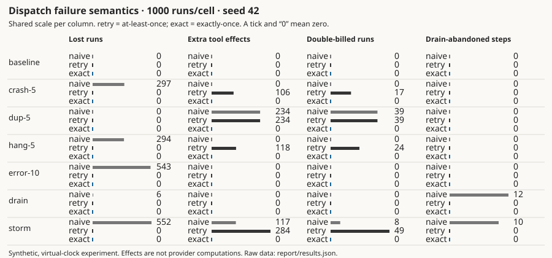

# agent-dispatch-lab

<!-- claim:start -->
Under combined crashes, duplicate deliveries, hangs, errors and a drain, at-least-once dispatch double-bills 4.9% of agent runs; idempotent exactly-once dispatch double-bills none, while 6.5% of its provider calls yield unused results.
<!-- claim:end -->

<picture>
  <source media="(prefers-color-scheme: dark)" srcset="report/results-dark.svg">
  
</picture>

Retries can recover progress while repeating effects. The keyed strategy keeps completion and uniqueness together.

## Why this matters for agents

An agent run often plans, calls several tools, synthesizes the results and bills for the work. These steps cross different failure boundaries. A successful model response does not prove that the tool's side effect was committed, or that the runtime recorded it before its worker died.

Consider a tool that charges a card. The charge succeeds, then the worker crashes before acknowledging the step. Dropping it leaves the run unfinished; retrying without a stable key can charge twice. Both outcomes can hide behind reassuring request-success metrics.

Model calls add another cost: retries consume compute even when their results are discarded. This lab separates completion, durable effects and unused provider calls, then injects failures at the boundaries where those numbers diverge.

## The workload

```text
plan → [tool_call × N] → synthesize → bill       N = 3–6

pending → claimed → provider_called → effect_written → committed
```

Tools append rows; billing appends charges. Stable keys are `run_id/step_id`. Runs arrive together and share 16 workers. Seeded log-normal latency has median approximately 300 ms, capped at 1.8 s to keep baseline fault-free. Injected hangs time out at 2 s.

## The three strategies

**Naive** executes once, appends effects and acknowledges. Errors and worker death lose progress; duplicate messages repeat writes.

**At-least-once** adds up to four retries with exponential backoff, crash redelivery after a 2 s visibility timeout, and drain handback. It does not check effect keys. A late write and its retry can both succeed.

**Exactly-once** retains retries but changes the acceptance and recovery contract:

- **Idempotent effects:** tool and billing ledgers enforce unique stable keys, including late writes.
- **Versioned handshake:** one owner wins; release increments the version and fences stale attempts.
- **Durable step log:** transitions precede the next action; completed provider results are recoverable by key.
- **Commit-before-bill:** billing refuses any uncommitted predecessor and deduplicates its own write.

During drain, claims stop; work has 150 ms to finish. Unfinished idempotent work is fenced and handed back. The replacement pool reuses the log.

<picture>
  <source media="(prefers-color-scheme: dark)" srcset="report/mechanism-dark.svg">
  
</picture>

Effect written, acknowledgement lost. The exact lane illustrates the `provider_called` recovery window: v1 reuses the cache and deduplicates the write; v0 is fenced. This is an illustration, not a recorded simulation trace; the [recovery test](internal/strategy/exactly_once_test.go) exercises that window.

## Failure modes

| Injector | Decision | Operational analogue |
|---|---|---|
| `worker-crash` | Die before acknowledgement; 50/50 before or after the effect | Process death during a write |
| `dup-delivery` | Enqueue another receipt, immediately or 350 ms later | Visibility expiry or rebalance |
| `provider-hang` | No reply; half complete late, half never complete | Retry racing an unknown outcome |
| `provider-error` | Retryable error without an effect | Overload or transient failure |
| `drain` | One rolling-deploy deadline | Lost work without handback |

Faults use keyed seed/step/attempt draws. Duplicates apply on enqueue. Drain occurs at half the fault-free batch time, fixed across strategies. See [`scenarios.go`](internal/sim/scenarios.go).

## Results

<picture>
  <source media="(prefers-color-scheme: dark)" srcset="report/results-grid-dark.svg">
  
</picture>

The full matrix: four invariants, seven scenarios. Each column uses a shared scale; a tick and a zero mean zero.

<!-- results:start -->
Runs per cell: 1000 · seed: 42 · workers: 16. Counts describe effects and completion; see the README’s cost discussion for batch timing.

| Scenario | Strategy | Completed | Lost | Duplicate effects | Double-billed | Wasted / provider calls | Drain abandoned |
|---|---|---:|---:|---:|---:|---:|---:|
| baseline | naive | 100.0% | 0 | 0 | 0 | 0 / 6405 | 0 |
| baseline | at-least-once | 100.0% | 0 | 0 | 0 | 0 / 6405 | 0 |
| baseline | exactly-once | 100.0% | 0 | 0 | 0 | 0 / 6405 | 0 |
| crash-5 | naive | 70.3% | 297 | 0 | 0 | 293 / 5997 | 0 |
| crash-5 | at-least-once | 100.0% | 0 | 106 | 17 | 328 / 6733 | 0 |
| crash-5 | exactly-once | 100.0% | 0 | 0 | 0 | 0 / 6405 | 0 |
| dup-5 | naive | 100.0% | 0 | 234 | 39 | 325 / 6730 | 0 |
| dup-5 | at-least-once | 100.0% | 0 | 234 | 39 | 325 / 6730 | 0 |
| dup-5 | exactly-once | 100.0% | 0 | 0 | 0 | 0 / 6405 | 0 |
| hang-5 | naive | 70.6% | 294 | 0 | 0 | 293 / 5975 | 0 |
| hang-5 | at-least-once | 100.0% | 0 | 118 | 24 | 337 / 6742 | 0 |
| hang-5 | exactly-once | 100.0% | 0 | 0 | 0 | 163 / 6568 | 0 |
| error-10 | naive | 45.7% | 543 | 0 | 0 | 568 / 5560 | 0 |
| error-10 | at-least-once | 100.0% | 0 | 0 | 0 | 737 / 7142 | 0 |
| error-10 | exactly-once | 100.0% | 0 | 0 | 0 | 737 / 7142 | 0 |
| drain | naive | 99.4% | 6 | 0 | 0 | 12 / 6399 | 12 |
| drain | at-least-once | 100.0% | 0 | 0 | 0 | 12 / 6417 | 0 |
| drain | exactly-once | 100.0% | 0 | 0 | 0 | 0 / 6405 | 0 |
| storm | naive | 44.8% | 552 | 117 | 8 | 759 / 5707 | 10 |
| storm | at-least-once | 100.0% | 0 | 284 | 49 | 984 / 7389 | 0 |
| storm | exactly-once | 100.0% | 0 | 0 | 0 | 448 / 6853 | 0 |

<!-- results:end -->

<!-- observations:start -->
In `dup-5`, retries show 100.0% completion but double-bill 39 of 1000 runs. Completion alone misses the failure.

In `error-10`, retries raise completion from 45.7% to 100.0%. Errors before an effect are the case retry handles well.

The naive drain abandons 12 steps and loses 6 runs; the idempotent strategy abandons none. These are counts of steps and runs, respectively.

In `storm`, retry writes 284 extra tool effects; exactly-once writes zero extra effects. The simulator counts extra writes, not merely affected keys.
<!-- observations:end -->

## What exactly-once costs

<!-- cost:start -->
In `storm`, exactly-once makes 6853 provider calls; 448 (6.5%) have unused results. Retry makes 7389 calls with 984 unused results. This waste includes failed and interrupted calls, not only an idempotency surcharge. Cached recovery can avoid a second call; an unavailable result can still require new computation.

The whole 1000-run storm batch takes 206.63s of virtual time with exactly-once, versus 221.78s with retry, using 16 workers. This is batch makespan through the last scheduled event, including late provider completions; it is not individual run latency or wall time. `results.json` retains `batch_latency_ms` and the queue-inclusive `p50_run_latency_ms` / `p99_run_latency_ms` for billed runs. Those percentiles measure time since the entire batch arrived, not provider response time.
<!-- cost:end -->

A result cache cannot recover an indefinitely hung computation. Recovery reuses a completed result when available; otherwise a fresh physical attempt may be needed. The guarantee is one **effect**, not one provider invocation. The eight-concurrent-dispatch test proves one call and one commit when the original owner stays healthy.

## Run it

Requires Go 1.22+; the core has zero external dependencies. No services, network or Docker are needed after cloning.

```sh
git clone https://github.com/kevinmamaqi/agent-dispatch-lab.git
cd agent-dispatch-lab
go run ./cmd/lab
go run ./cmd/lab -scenario storm -strategy at-least-once -v
make report
make lint
go test ./...
```

Flags: `-runs` (1000), `-seed` (42), `-workers` (16), `-scenario`, `-strategy`, `-v`. Report mode accepts runs/seed/workers and requires the full matrix. It refreshes JSON, Markdown, README measurements, and light/dark versions of the storm chart, full grid and mechanism animation. CI rejects regeneration drift.

Verbose output records violations and fault events. Duplicate effects count extra writes; double billing counts affected runs. Wasted calls include errors and ignored duplicate results; billing writes are excluded from provider-call cost.

## Limitations

This is an in-process, virtual-clock model, not a production benchmark. The four-method `Store` interface governs step-log recovery. A persistent implementation must also enforce ledger uniqueness and billing prerequisites transactionally. The in-memory log survives simulated worker death, not process or machine restart.

Hang/error injection includes the billing write’s acknowledgement; without that boundary, a hang-only scenario could not demonstrate duplicate billing honestly. Percentiles include batch queue wait and only billed runs: losing runs can make latency look better. A released worker does not cancel upstream computation, so faults can also change effective provider concurrency. There are no network partitions, multi-region consensus, heartbeat/clock-skew faults or arbitrary unkeyed external side effects. An event limit fails the run rather than reporting partial success.

## About

Written from scratch by Kevin Mamaqi Kapllani, Tech Lead / Engineering Manager in Barcelona. [kevinmamaqi.com](https://kevinmamaqi.com/).

The companion post will be written from these results; it is not bundled with the lab.
